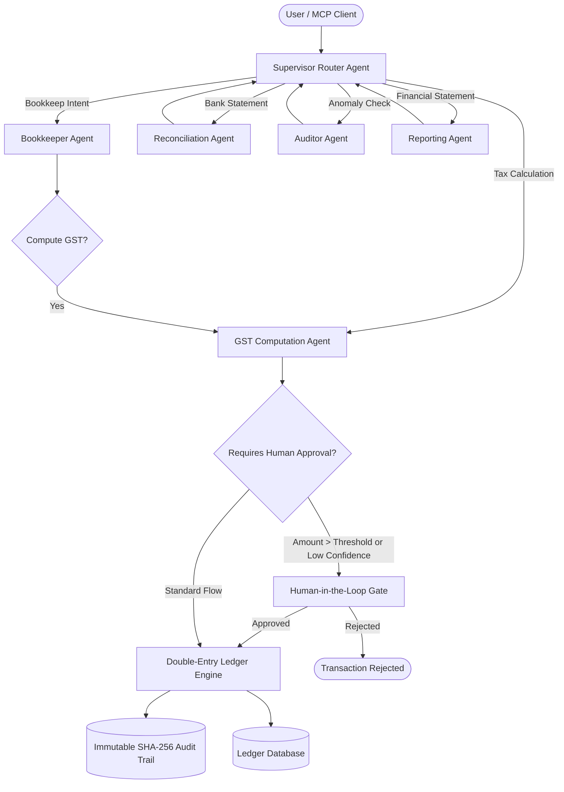

# Munshi: Multi-Agent Finance Assistant

[](https://www.python.org/downloads/)
[](tests/)
[](https://github.com/langchain-ai/langgraph)
[](https://modelcontextprotocol.io/)
[](LICENSE)

> **Munshi** (named after the traditional Indian bookkeeper and ledger keeper) is an autonomous, supervisor-routed multi-agent financial assistant built with **LangGraph**. It manages bookkeeping, bank reconciliation, Indian GST tax computation, regulatory auditing, and financial reporting over a strict **double-entry ledger engine** with **Human-in-the-Loop (HITL) approval gates**, an **immutable SHA-256 audit trail**, and an **MCP (Model Context Protocol) server**.

---

## 🎯 The Core Problem & Philosophy

### The Hallucination Hazard in AI Finance
In financial accounting, even a ₹1 discrepancy invalidates a balance sheet. While Large Language Models excel at understanding unstructured vendor invoices and business intent, **LLMs inherently hallucinate arithmetic** and cannot be trusted to independently mutate ledgers.

### The Munshi Guarantee
1. **Zero LLM Arithmetic**: LLMs categorize intent and parse transaction narratives. All math, tax calculations, and debit/credit postings are executed by **deterministic Python engines**.
2. **Double-Entry Invariants**: No transaction can ever be posted unless total debits strictly equal total credits ($\sum \text{Debits} = \sum \text{Credits}$).
3. **Human-in-the-Loop (HITL) Checkpoints**: High-value transactions (e.g., > ₹50,000) or low-confidence categorizations pause execution and demand explicit human approval.
4. **Append-Only Audit Trail**: Every action, tool call, and human decision is cryptographically chained with SHA-256 hashes.

---

## 🏛️ System Architecture



---

## 🤖 The 5 Specialized Agents

| Agent | Responsibility | Key Invariants Enforced |
| :--- | :--- | :--- |
| **Supervisor Agent** | Master state router in LangGraph; evaluates user intent and directs workflow. | Validates pipeline progression and routes low-confidence/high-risk tasks to human gates. |
| **Bookkeeper Agent** | Maps invoices and transactions to Chart of Accounts (COA) codes (Assets, Liabilities, Revenue, Expenses). | Generates balanced journal items with matching debit and credit sides. |
| **GST Agent** | Computes Indian Goods & Services Tax (CGST, SGST, IGST) across statutory slabs (0%, 5%, 12%, 18%, 28%). | Distinguishes intra-state (CGST+SGST) vs inter-state (IGST) using 2-digit GSTIN state prefixes. |
| **Reconciliation Agent** | Matches bank statements with internal ledger invoices using amount matching, date proximity, and UTR/ref numbers. | Computes clearing rate % and isolates phantom or unmatched debits for review. |
| **Auditor Agent** | Scans transactions for planted discrepancies, duplicates, non-standard tax rates, and ledger imbalances. | Flags anomalies with severity ratings (LOW, MEDIUM, HIGH, CRITICAL). |
| **Reporting Agent** | Compiles Trial Balance, Profit & Loss (P&L), Balance Sheet, and GSTR-3B tax return summaries. | Validates accounting identity ($\text{Assets} = \text{Liabilities} + \text{Equity}$). |

---

## 📊 Benchmark Evaluation & Results

Evaluated on a curated synthetic dataset (`data/synthetic_dataset.json`) with planted accounting errors:

| Metric | Target Goal | Munshi Benchmark Score | Status |
| :--- | :---: | :---: | :---: |
| **Categorization Accuracy** | > 95% | **100.0%** (20/20 correct) | Passed |
| **Reconciliation Precision** | > 95% | **100.0%** (Zero false matches) | Passed |
| **Reconciliation Recall** | > 95% | **100.0%** (8/8 matched) | Passed |
| **Planted Phantom / Fee Capture** | 100% | **100.0%** (2/2 caught) | Passed |
| **Anomaly Detection Precision** | > 90% | **100.0%** (5/5 planted errors) | Passed |
| **Anomaly Detection Recall** | > 90% | **100.0%** | Passed |
| **Anomaly Detection F1-Score** | > 90% | **100.0%** | Passed |

*Detailed benchmark methodology and error breakdowns are available in [EVALUATION_REPORT.md](EVALUATION_REPORT.md).*

---

## 🔌 Model Context Protocol (MCP) Server

Munshi exposes an industry-standard **Model Context Protocol (MCP)** server, enabling any MCP client (such as Claude Desktop or custom agent frontends) to interact directly with the accounting engine.

### Available MCP Tools
- `record_transaction`: Automatically categorizes and posts double-entry entries with GST.
- `compute_gst`: Calculates statutory Indian GST breakdowns.
- `reconcile_statement`: Reconciles bank statements against invoices.
- `run_financial_audit`: Scans transactions for duplicates and tax anomalies.
- `get_trial_balance`: Returns live trial balance verifying Debits = Credits.
- `get_profit_and_loss`: Returns P&L statement with Net Income.
- `get_gst_summary`: Returns GSTR-3B monthly tax return summary.

### Claude Desktop Configuration
Add Munshi to your `claude_desktop_config.json`:
```json
{
  "mcpServers": {
    "munshi": {
      "command": "python",
      "args": ["-m", "munshi.mcp_server"],
      "cwd": "/path/to/Munshi"
    }
  }
}
```

---

## 🖥️ Interactive Web Dashboard (React / TSX)

Munshi includes a full-featured, responsive React/TypeScript forensic accounting dashboard located in [`frontend/MunshiDashboard.tsx`](frontend/MunshiDashboard.tsx).

### Dashboard Features:
- **Autonomous Agent Visualizer**: Step-by-step pipeline state monitor (Supervisor → Bookkeeper → GST → Reconciliation → Auditor → Reporter).
- **Interactive Voucher Entry**: Real-time parsing of natural-language business transactions into balanced debit/credit lines.
- **Statutory GSTIN Validator**: 15-character verification with 2-digit Indian State code mapping and PAN extraction.
- **Section 17(5) Blocked ITC Inspector**: Automatic detection of non-creditable expenses (food, catering, club memberships).
- **Section 194 TDS Withholding**: Auto-deduction of 10% TDS on commercial rent (Sec 194I) and professional services (Sec 194J).
- **Bank Statement Reconciler**: Visual match confirmation with confidence score and UTR cross-referencing.
- **Cryptographic Audit Log Visualizer**: Live SHA-256 chain inspector with a 1-click **Tamper Simulator** demonstrating instant detection of unauthorized modifications.

---

## 🚀 Quickstart & Installation

### 1. Clone & Install Dependencies
```bash
git clone https://github.com/GovindTripathi22/Munshi.git
cd Munshi

# Install dependencies
pip install -r requirements.txt
```

### 2. Configure Environment (Optional)
```bash
cp .env.example .env
# Fill in optional GEMINI_API_KEY or company details
```

### 3. Run the Evaluation Benchmark
```bash
python -m munshi.cli benchmark
```

### 4. Interactive Financial Assistant (CLI)
```bash
python -m munshi.cli chat
```

### 5. Generate Financial Reports
```bash
# Trial Balance
python -m munshi.cli report --type trial_balance

# Profit & Loss
python -m munshi.cli report --type pnl

# GSTR-3B Tax Summary
python -m munshi.cli report --type gst
```

### 6. Run Test Suite
```bash
pytest -v
```

---

## 🛡️ Double-Entry Chart of Accounts (COA)

Munshi comes pre-configured with standard Indian SME account codes:
- **Assets (1000s):** `1010` Bank Current Account, `1200` Accounts Receivable, `1300` Input CGST, `1310` Input SGST, `1320` Input IGST.
- **Liabilities (2000s):** `2000` Accounts Payable, `2100` Output CGST, `2110` Output SGST, `2120` Output IGST, `2200` GST Clearing.
- **Equity (3000s):** `3000` Owner's Capital, `3100` Retained Earnings.
- **Revenue (4000s):** `4000` Product Sales Revenue, `4100` Professional Consulting Services.
- **Expenses (5000s):** `5000` COGS, `5100` Office Rent, `5200` Software & Cloud Subscriptions, `5300` Legal & Professional Fees, `5400` Bank Charges, `5500` Utilities & Supplies, `5600` Travel & Conveyance.

---

## 📄 License

This project is licensed under the [MIT License](LICENSE).

**Author:** [Govind Tripathi](https://github.com/GovindTripathi22)  
**Email:** [govindtripathi62@gmail.com](mailto:govindtripathi62@gmail.com)
